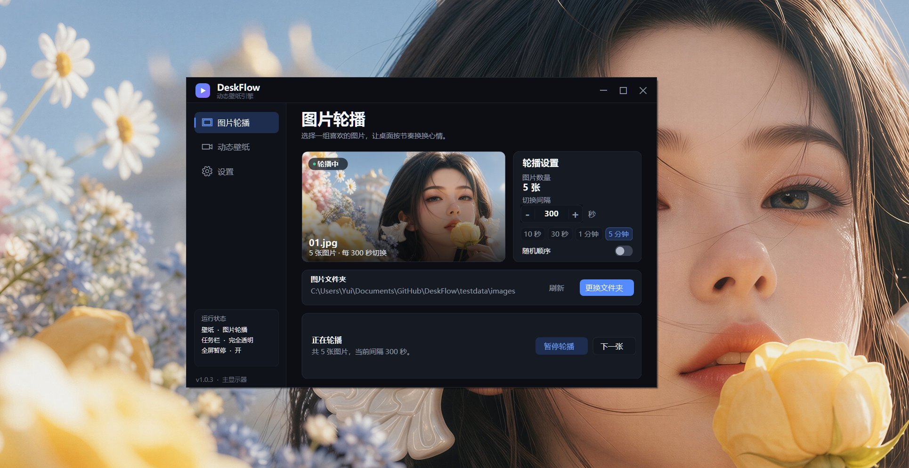
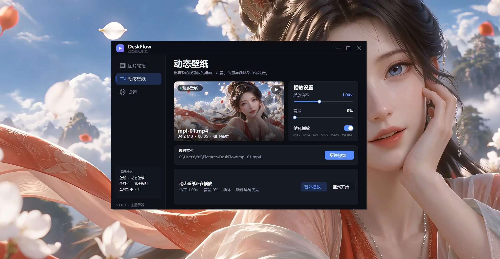
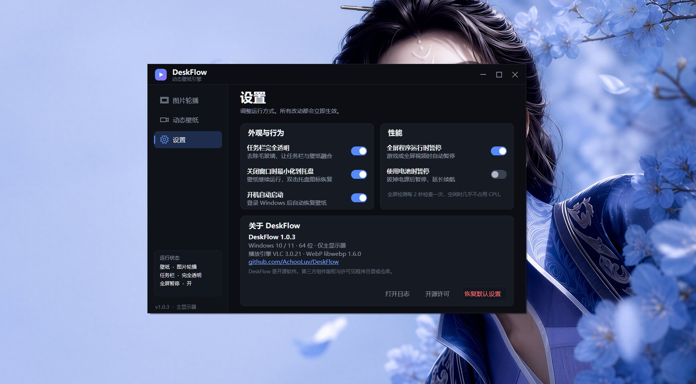

# DeskFlow — Windows 动态壁纸引擎 / Live Wallpaper Engine

DeskFlow 是一个**轻量、开源、免费的 Windows 10/11 动态壁纸引擎**：把图片文件夹变成自动轮播的桌面壁纸，或把 MKV / MP4 / AVI 视频放上桌面。它常驻托盘、占用克制，并在全屏游戏、锁屏或电池模式下自动暂停。

关键词：Windows 动态壁纸、视频壁纸、图片轮播壁纸、桌面壁纸引擎、Live Wallpaper、Video Wallpaper、Wallpaper Engine 替代品、Lively Wallpaper 替代品。



[](https://github.com/AchooLuv/DeskFlow/releases)
[](LICENSE)
[](https://github.com/AchooLuv/DeskFlow/releases)

## 为什么选择 DeskFlow

- **轻量**：视频走 VLC 硬件解码，图片只解码一次并缓存，不做逐帧 GDI+ 绘制。
- **简单**：单文件 exe，内置播放引擎，不需要安装 VLC、.NET 运行时或额外解码器。
- **安静**：全屏程序、锁屏、电池模式下自动暂停，不抢游戏和视频的性能。
- **桌面级整合**：壁纸挂在桌面图标下方，任务栏默认完全透明，不使用毛玻璃。
- **无订阅、无广告、开源**：GPLv3，源码完全公开。

## 功能

### 图片轮播壁纸

- 支持 **WEBP、JPG/JPEG、PNG、BMP、GIF**（静态首帧）。
- 可设置轮播间隔（3 秒 – 1 小时），支持随机顺序。
- 直接选择一个图片文件夹作为轮播源，自动识别图片；支持刷新列表。
- 图片按“填满屏幕”方式缩放，保留原始比例并居中裁切。
- 支持 JPEG EXIF 方向自动纠正；系统没有 WebP 解码器时由内置 `dwebp` 解码。
- 默认点击左侧“图片轮播 / 动态壁纸”只打开页面，不会立刻切换壁纸；使用页面内的“应用为壁纸”按钮切换。可在设置中开启“点击菜单直接切换壁纸”。

### 视频动态壁纸



- 支持 **MKV、MP4、AVI、MOV、WMV、WEBM、FLV、M4V、TS、MPG** 等常见格式。
- 播放倍率 **0.25× – 2.00×**。
- 音量 **0 – 100%**，默认静音。
- 循环播放默认开启，可关闭。
- 使用 VLC 3.0.21 播放引擎，优先硬件解码；视频嵌入桌面 WorkerW，位于桌面图标下方。
- 选择视频后，软件内自动抓取并显示视频封面。

### 桌面与系统集成



- **任务栏默认完全透明**，不使用毛玻璃 / 亚克力效果，并会在 Explorer 重建后自动恢复。
- 全屏游戏或全屏视频运行时自动暂停壁纸。
- 使用电池时可自动暂停，延长续航。
- 锁屏时暂停，解锁后恢复。
- 关闭窗口默认最小化到托盘；托盘菜单可暂停、下一张、切换任务栏透明或退出。
- 可选开机自动启动。
- 单实例运行；重复启动会唤醒已经运行的 DeskFlow。

## 下载与安装

从 [GitHub Releases](https://github.com/AchooLuv/DeskFlow/releases/latest) 下载最新版：

- **`DeskFlow.exe`**：单文件便携版，内置 VLC 播放引擎，推荐。
- **`DeskFlow-*-win64.zip`**：含程序、README、许可文件与截图的便携包。

首次启动会把内置播放组件释放到 `%LOCALAPPDATA%\DeskFlow\runtime\vlc-3.0.21-slim2`，约 40 MB；之后启动无需等待。如果该目录不可写，会自动回退到用户数据目录或 `%TEMP%\DeskFlow`。

程序未购买代码签名证书，Windows SmartScreen 可能提示“未知发布者”。请核对 Releases 页面或 `RELEASE_NOTES.md` 中的 SHA-256 后运行。

## 使用

1. 双击 `DeskFlow.exe`。
2. **图片轮播**：选择图片文件夹，设置间隔；壁纸立即开始轮播。
3. **动态壁纸**：选择视频，调整倍率、音量或循环；壁纸立即播放。
4. 已配置两种壁纸后，点击左侧“图片轮播 / 动态壁纸”打开对应页面，再点“应用为壁纸”切换；也可在设置里开启点击直接切换。
5. 关闭窗口后程序仍在托盘运行。右键托盘图标可以暂停、下一张或退出。

设置保存在 `%APPDATA%\DeskFlow\settings.json`，日志在 `%LOCALAPPDATA%\DeskFlow\DeskFlow.log`。

## 系统要求

- **Windows 10（1809 及以上）/ Windows 11，64 位。**
- 使用 Windows 自带的 .NET Framework 4.8，不需要单独安装 .NET。
- 不需要单独安装 VLC；播放引擎已内置。

### 为什么不支持 Windows 7 / 8.1

技术上可以勉强运行，但需要额外处理旧版 WorkerW、任务栏接口、.NET 运行时和 VLC 兼容性，而 Windows 7/8.1 已停止安全更新，实际收益很低。因此本项目只针对 Windows 10/11 64 位维护和测试。

## 性能设计

DeskFlow 刻意保持简单，避免为了“动态壁纸”付出不必要的开销：

- 视频由 VLC 硬件解码优先播放，不经过逐帧 GDI+ 绘制。
- 图片只在切换时解码一次，并缩放到屏幕尺寸后缓存；绘制时直接贴图。
- 轮播使用单个定时器，不轮询文件系统。
- 全屏检测每 2 秒执行一次轻量系统查询；空闲时不进行高频重绘。
- 锁屏、全屏程序、电池模式会暂停视频/轮播。
- 任务栏透明只在启动、系统事件和低频率维护时重新应用，不做高频调用。

## 常见问题

**需要安装 VLC 吗？**  
不需要。VLC 3.0.21 播放组件已压缩内置于 `DeskFlow.exe`，首次启动自动释放。

**支持哪些图片和视频格式？**  
图片：WEBP、JPG/JPEG、PNG、BMP、GIF（静态首帧）。视频：MKV、MP4、AVI、MOV、WMV、WEBM、FLV、M4V、TS、MPG 等。

**任务栏透明在 Windows 11 上为什么有时无效？**  
Windows 11 22H2（22621.1343）之后，微软限制了第三方程序修改任务栏背景。DeskFlow 会持续尝试完全透明样式；如果系统接管了任务栏绘制，任务栏会保持系统默认外观。这是系统限制，不影响壁纸本身。

**支持多显示器吗？**  
当前版本只把壁纸铺在主显示器上；多显示器扩展桌面暂未支持。

**和 Wallpaper Engine / Lively Wallpaper 有什么区别？**  
DeskFlow 更小、更专注：只做图片轮播和视频壁纸，不内置创意工坊、网页壁纸或复杂插件系统。它适合只想要“视频/图片动态桌面”的用户。

## 构建

构建产物是单文件 `DeskFlow.exe`，VLC 运行库会被压缩后嵌入可执行文件。

需要：

- Windows 10/11 x64。
- .NET Framework 4.8（Windows 自带）。
- Roslyn C# 编译器（例如 NuGet 包 `Microsoft.Net.Compilers` 3.11，解压到 `.cache\roslyn`）。
- VLC 3.0.21 win64 便携包，解压到 `.cache\vlc\vlc-3.0.21`。
- 官方 libwebp 1.6.0 Windows x64 包中的 `dwebp.exe`，放到 `assets\tools\dwebp.exe`。

然后运行：

```powershell
powershell -NoProfile -ExecutionPolicy Bypass -File build.ps1
```

输出：

- `build\DeskFlow.exe`：单文件可执行程序。
- `build\DeskFlow-1.0.14-win64.zip`：含程序、README 与许可文件的便携包。

### 精简构建

如果只需要本地视频播放，可以构建精简版；它会按 `assets\runtime-plugins-slim.txt` 只打包必要的 VLC 插件，去掉 VLC GUI、编码器、串流、可视化和网络访问插件：

```powershell
powershell -NoProfile -ExecutionPolicy Bypass -File build-slim.ps1
```

输出：

- `build\DeskFlow-slim.exe`：约 19 MB。
- `build\DeskFlow-1.0.14-slim-win64.zip`：约 19 MB 的便携包。
- 首次启动释放的 runtime 约 40 MB。

已测试的格式包括 MKV、MP4、AVI、MOV、WMV、WEBM，以及 H.264、HEVC、AV1、VP8、VP9、MPEG-2 编码。完整版 `build.ps1` 保留作为兼容性兜底。

## 已知限制

- 当前版本只把壁纸铺在主显示器上；多显示器扩展桌面暂未支持。
- 图片轮播不递归扫描子文件夹。
- Windows 11 22H2（22621.1343）之后，微软限制了第三方程序修改任务栏背景；DeskFlow 会持续尝试，若系统接管则保持默认外观。
- 任务栏透明属于未公开 API 的兼容实现，在部分自定义主题或第三方任务栏工具共存时可能失效。
- 未购买代码签名证书，SmartScreen 可能提示“未知发布者”。

## English

DeskFlow is a lightweight, open-source **live wallpaper engine for Windows 10/11**. It supports **image slideshow wallpapers** (WEBP, JPG, PNG, BMP, GIF) and **video wallpapers** (MKV, MP4, AVI, MOV, WMV, WEBM) with playback speed, volume, looping, hardware-accelerated decoding, a fully transparent taskbar, and automatic pause when a fullscreen app, lock screen, or battery mode is active. It is a simple, free alternative to Wallpaper Engine and Lively Wallpaper for users who only need image/video desktop wallpapers.

## 许可

DeskFlow 以 **GNU GPL v3** 发布。它动态加载 VLC 3.0.21（GPLv2+），并使用 libwebp 的 `dwebp`（BSD-3-Clause）。完整许可见 [LICENSE](LICENSE) 与 [THIRD-PARTY-NOTICES.txt](THIRD-PARTY-NOTICES.txt)，程序“设置 → 开源许可”中也可查看。

源码：<https://github.com/AchooLuv/DeskFlow>
